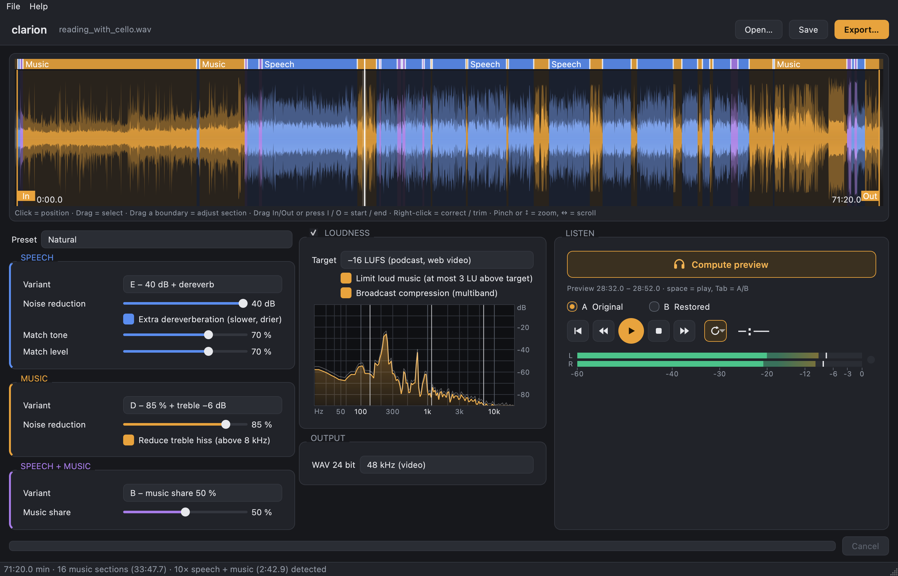

<p align="center"></p>

# clarion

**Clean up speech recorded with a field recorder or a camera – including readings with accompanying
music.** A handheld recorder on the table or the microphone on a camera captures a reading, a talk or an
interview honestly, but also the recorder's hiss, the room's echo, the air conditioning and the PA
loudspeaker. clarion cleans the voice with a speech AI and treats the music between and under the words
gently, so a cello or a piano is not destroyed the way a normal noise remover would destroy it.



## Made for

- **Readings with accompanying music:** a book or poetry reading with a cellist, a pianist or a guitar
  between the texts, sometimes also under the voice.
- **Speech recordings in real rooms:** lectures, talks, sermons, panel discussions, interviews, oral
  history – recorded with a field recorder such as a Zoom or Tascam handheld, or with a phone.
- **Camera sound:** the audio track of a video from a camera or phone (MOV, MP4, MTS, …). clarion reads
  the first audio track and exports a WAV of exactly the same length and timing, so it lines up with the
  picture again in your video editor.
- **Long takes:** one continuous file of an hour or more, as it comes off the recorder (WAV, 16/24-bit
  or 32-bit float, any sample rate).

## Why

Speech-enhancement AIs are excellent at removing noise and room sound from a voice, but they treat
everything that is not speech as noise: a cello, a piano or applause gets wiped out or turns into
watery artefacts. Classic noise reduction keeps the music, but cannot clean a voice nearly as well.
With a field recorder or a camera both happen in the same file: the voice needs strong cleaning, the music needs a
light touch. clarion detects which parts of a recording are speech, music, or speech over music, and
processes each part with the method that suits it – in one pass, with smooth transitions. It also
evens out the voice when the speaker moves between the room and the PA microphone.

## Features

- **Speech:** AI noise reduction ([DeepFilterNet3](https://github.com/Rikorose/DeepFilterNet)), optional
  extra dereverberation (WPE), tone and level matching when the speaker moves relative to the microphone.
- **Music:** gentle spectral noise reduction with a noise profile from nearby quiet passages, optional
  treble-hiss reduction. The room sound stays.
- **Speech + music:** the AI voice plus a denoised share of the original, so music under a voice stays
  continuous.
- **Automatic detection** of speech / music / speech + music. Fix it in the timeline: drag a boundary,
  or right-click to relabel.
- **Loudness** to a LUFS target (EBU R128 / ITU-R BS.1770) with a look-ahead limiter, an optional
  ceiling for loud music, and an optional four-band "broadcast" compressor. Live spectrum and level meter.
- **A/B preview** at any position, recomputed automatically when you change a setting, with instant
  switching between recent previews.
- **Trim** start and end with In/Out markers, **projects** (`.klang`) that keep all markers and settings,
  **export** as 24-bit WAV (48 kHz or the original sample rate).
- Works on long files: one-hour recordings stay within a few GB of RAM.

## Install and run

clarion runs on macOS 14 (Sonoma) or newer. Linux should work from source; Windows is untested.
For videos and M4A files, install [ffmpeg](https://ffmpeg.org) (`brew install ffmpeg`).

### Option 1: download the app (easiest)

1. Open the [Releases](../../releases) page and download `clarion-<version>-macos-arm64.zip` (Macs with
   Apple Silicon, M1 or newer). For Intel Macs there is no download yet: use option 2.
2. Double-click the zip and drag **clarion.app** into your *Applications* folder.
3. Open it. Because clarion is free software without a paid Apple developer certificate, macOS asks
   for confirmation the first time:
   - **macOS 15 (Sequoia) and newer:** the warning says Apple could not check the app – click *Done*.
     Open *System Settings → Privacy & Security*, scroll down to "clarion was blocked…" and click
     **Open Anyway**, then confirm.
   - **macOS 14:** right-click (or Control-click) clarion.app → *Open* → *Open*.

   This is needed only once.

The first time you open a recording, clarion downloads the speech AI (about 35 MB, see below), so you
need an internet connection then.

The app also contains the command line:
`/Applications/clarion.app/Contents/MacOS/clarion --cli recording.wav` (see [Command line](#command-line)).

### Option 2: run from the source code

1. Download the repository ("Code → Download ZIP") and unpack it, or `git clone` it.
2. Double-click **`clarion.command`**. macOS asks for confirmation as described above (on macOS 15:
   *Open Anyway* in *Privacy & Security*). The first start installs [uv](https://docs.astral.sh/uv/)
   and the Python packages, which takes 1–2 minutes; later starts are quick.

Or in a terminal:

```bash
uv sync
uv run klangrestaurator
```

To work on clarion itself, see [CONTRIBUTING.md](CONTRIBUTING.md).

### Where clarion keeps its files

- The speech AI: the `deep-filter` program from the
  [DeepFilterNet releases](https://github.com/Rikorose/DeepFilterNet/releases), stored in
  `~/Library/Application Support/Klangrestaurator/`.
- Analyses: `~/Library/Caches/Klangrestaurator/` (about twice the size of each recording). You can delete
  this folder at any time; clarion recomputes what it needs.

To uninstall, delete clarion.app and these two folders.

## How to use

1. Drop an audio file (WAV, AIFF, FLAC, MP3) or a video on the window. M4A and videos need
   [ffmpeg](https://ffmpeg.org) (`brew install ffmpeg`). The first analysis runs the AI over the whole
   recording, which takes about a quarter of its duration; it is cached afterwards.
2. Check the sections – **speech** (blue), **music** (amber), **speech + music** (violet) – and correct
   them by dragging a boundary or with a right-click.
3. Pick a preset or variants, click **Compute preview**, press **Space** to play and **Tab** to switch
   between A (original) and B (restored).
4. **Export…**

**Video:** export without trimming (no In/Out markers) and the WAV starts and ends exactly like the
video's sound – place it at the start of the clip and mute the original track. With a trim, the WAV
starts at the In marker instead.

| Preset  | Speech                 | Music                | Speech + music   |
|---------|------------------------|----------------------|------------------|
| Natural | 40 dB + dereverb       | 85 % + treble −6 dB  | music share 50 % |
| Strong  | 40 dB + dereverb       | 95 %, higher threshold | music share 25 % |
| Gentle  | 20 dB                  | 70 %                 | music share 75 % |

### Command line

```bash
uv run klangrestaurator-cli recording.wav                       # preset Natural, −16 LUFS, 48 kHz
uv run klangrestaurator-cli *.wav --preset Strong --keep-rate
uv run klangrestaurator-cli recording.wav --broadcast --lufs -14
uv run klangrestaurator-cli recording.wav --segments            # only list the detected sections
uv run klangrestaurator-cli --help
```

## How it works

DeepFilterNet removes only 2–6 dB from speech but 30–50 dB from instruments, applause or crowd noise. That
difference is the speech/music detector – no extra classifier is needed. Each section then goes through
its own chain (speech: AI + optional WPE; music: spectral noise gating; speech + music: a mix of both),
and the chains are cross-faded at the boundaries. Loudness is measured according to ITU-R BS.1770.
Details are in [CLAUDE.md](CLAUDE.md), the developer notes.

## Building a macOS app

```bash
./scripts/build_app.sh        # → dist/clarion-<version>-macos-<arch>.zip
```

The zip holds `clarion.app` for the architecture of the Mac that built it, ad-hoc signed and with
[LICENSE](LICENSE) and [THIRD_PARTY_NOTICES.md](THIRD_PARTY_NOTICES.md) inside; upload it to a GitHub
release. The app bundles Qt/PySide6 and other libraries under the LGPL (see the notices for what that
requires when distributing it).

## Development

See [CONTRIBUTING.md](CONTRIBUTING.md): setup, tests, where things are, and how to propose changes.

## Credits

clarion stands on the work of others. Thank you!

- **DeepFilterNet** by Hendrik Schröter, Tobias Rosenkranz, Alberto N. Escalante-B. and Andreas Maier –
  the speech AI. If you use clarion in research, please cite their paper:
  H. Schröter, T. Rosenkranz, A. N. Escalante-B., A. Maier: *DeepFilterNet: Perceptually Motivated
  Real-Time Speech Enhancement*, INTERSPEECH 2023.
- **noisereduce** by Tim Sainburg – spectral noise gating for music. T. Sainburg, M. Thielk,
  T. Q. Gentner: *Finding, visualizing, and quantifying latent structure across diverse animal vocal
  repertoires*, PLoS Computational Biology 16(10), 2020.
- **nara_wpe** by Lukas Drude, Jahn Heymann, Christoph Boeddeker and Reinhold Haeb-Umbach –
  dereverberation (WPE). L. Drude et al.: *NARA-WPE: A Python package for weighted prediction error
  dereverberation in Numpy and Tensorflow for online and offline processing*, ITG Fachtagung
  Sprachkommunikation 2018.
- **Qt / PySide6**, **NumPy**, **SciPy**, **python-soundfile / libsndfile** – the foundation.
- Loudness measurement follows **ITU-R BS.1770** and **EBU R128**.
- The optional "broadcast" compressor uses the parameter values of the "Broadcast" preset of Adobe
  Audition's Multiband Compressor, as shown in that application; the implementation is clarion's own.

The full list of components and their licenses is in [THIRD_PARTY_NOTICES.md](THIRD_PARTY_NOTICES.md).

clarion was developed by Thomas Treu with the help of [Claude Code](https://claude.com/claude-code)
(Anthropic).

Adobe and Audition are trademarks of Adobe Inc.; Zoom and Tascam are trademarks of their respective
owners. clarion is an independent project and is not affiliated with or endorsed by any of them or by
the authors of the libraries above.

## License

[MIT](LICENSE) © 2026 Thomas Treu. Third-party components keep their own licenses, see
[THIRD_PARTY_NOTICES.md](THIRD_PARTY_NOTICES.md).
